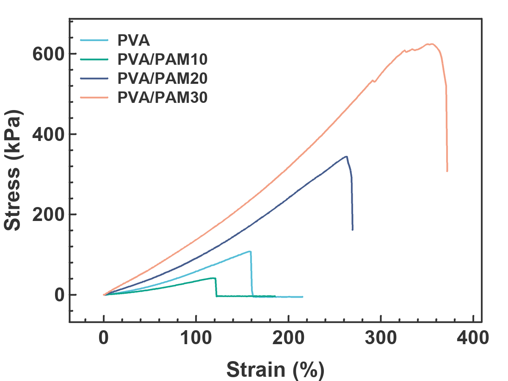
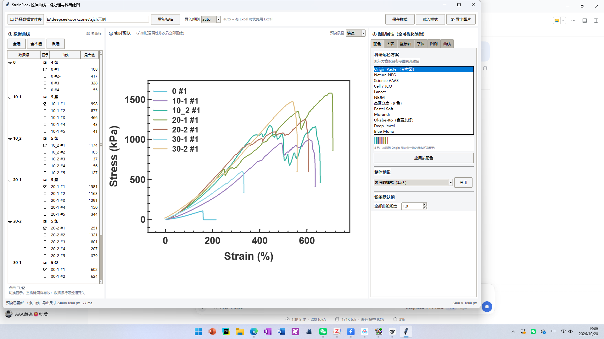
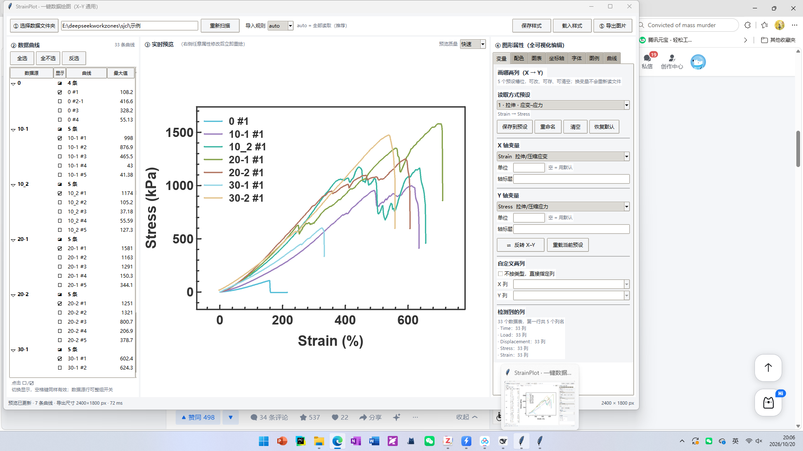
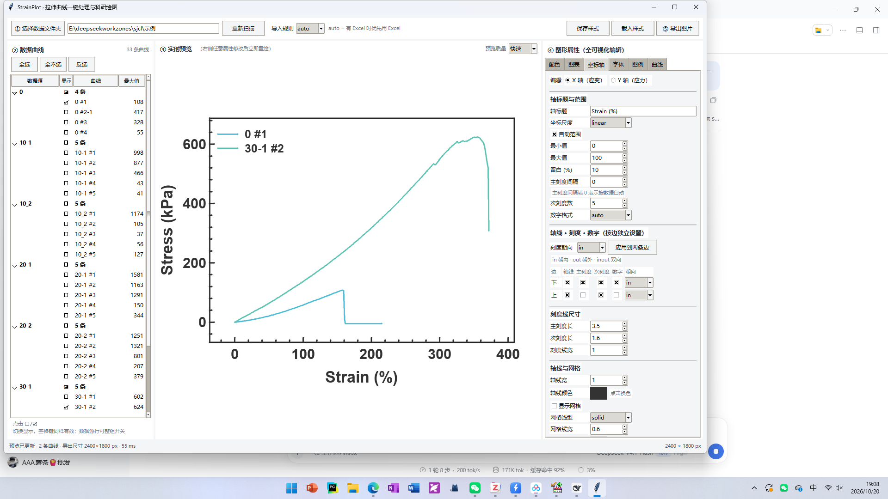
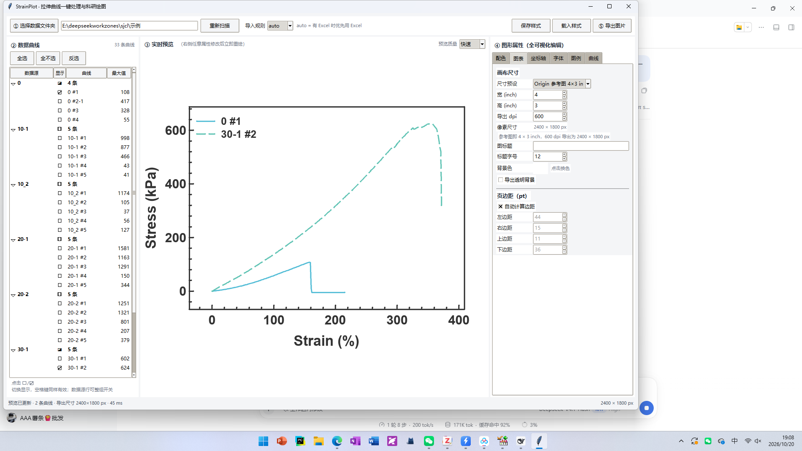
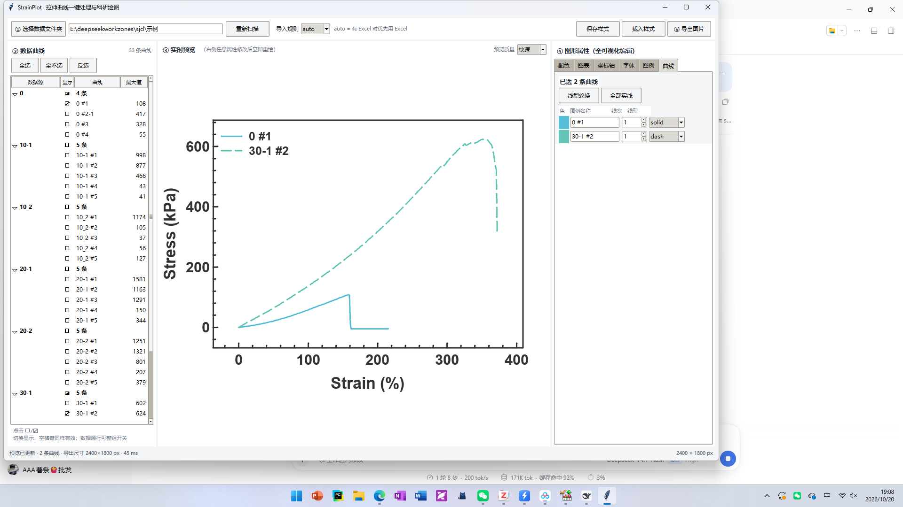
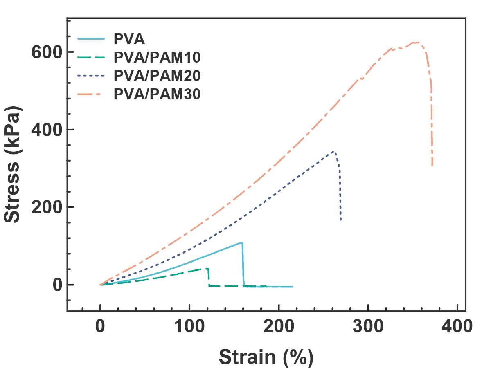
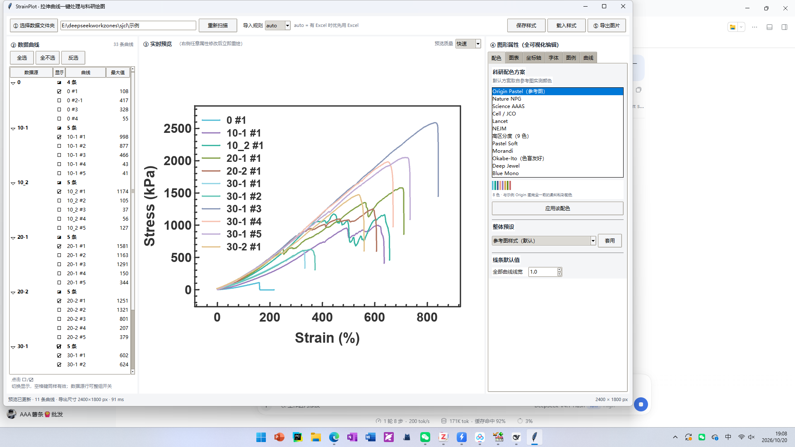

# StrainPlot · 一键数据绘图（X–Y 通用）

把一个文件夹里的实验数据（Instron `.is_tens` 原始导出 / Excel / CSV / TXT）自动读成 **X–Y 曲线**，
按你给的 Origin 图样式实时预览、可视化调参，并导出 **PNG / SVG / TIFF / PDF**。

v2 起不再写死"应变–应力"：40 种常见物理量（力学 / 热分析 / 光谱 / 电化学 / 化学）自动识别，
5 个**可编辑**的读取方式预设（第 1 个出厂即应力–应变，其余自定），也能任选任意两列自定义作画，
**换变量不用重新读文件**。

纯 Python 实现（numpy + Pillow + tkinter），**不依赖 matplotlib，不需要安装 Origin**。
渲染引擎是按参考图逐像素反推自己写的，输出与 Origin 导出结果 1:1 对齐。



> 上面这张图不是示意图：它由 `示例/0.is_tens_RawData` 等原始 CSV 直接渲染而来，曲线与你给的 `1T.png` 完全一致；
> `docs/preview2.png` 对应你的 `2T.png`（换了另外 4 根试样）。
> 同一套默认样式画 TGA / UV-Vis：`docs/example-tga.png`、`docs/example-uvvis.png`。

### 界面一览



| 变量映射（v2 新增） | 坐标轴（按边独立设置） | 图表（尺寸 / 边距） |
| --- | --- | --- |
|  |  |  |



---

## 1. 启动

### 方式 A：免安装版（推荐，不需要装 Python）

| 系统 | 文件 | 用法 |
| --- | --- | --- |
| Windows 10/11 x64 | `dist/StrainPlot-1.0.0-win64.zip` | 解压到任意目录（含中文、含空格都行），双击 `StrainPlot.exe` |
| macOS 10.15+ | `dist/StrainPlot-1.0.0-macos.zip` | 解压，双击 `StrainPlot.app` |

> 现有的两个 zip 是 **v1.0.0（拉伸专用版）** 的产物。v2 新增了变量系统，等功能定稿后再重新打包发布
> （脚本已就绪：`packaging/build_win_portable.py`、`packaging/build_macos_bundle.py`，版本号在 `strainplot/__init__.py`）。
> 现在想试 v2 直接用下面的方式 B。

Windows 版自带 Python 3.12 运行时和全部依赖，解压后约 100 MB；不写注册表、不装系统服务，删目录即卸载。

macOS 版是一个真正的 `.app`（带图标），首次启动会在
`~/Library/Application Support/StrainPlot/venv` 建一个独立环境并联网安装
`pillow / numpy / openpyxl`（一次即可，之后离线可用），因此**需要本机有 Python 3.9+**
（推荐 python.org 安装包，自带 tkinter；Homebrew 版需 `brew install python-tk@3.12`）。
想要完全自带运行时、不依赖本机 Python 的 `.app`，在 macOS 上执行 `bash packaging/macos/build_macos.sh`。

> 本包未做 Apple 公证（无开发者账号），若提示“无法验证开发者”：
> 右键 `StrainPlot.app` → 打开；或 `xattr -dr com.apple.quarantine StrainPlot.app`。

### 方式 B：源码运行

**双击 `run.bat`**（Windows，会自动寻找本机可用的 Python），或：

```bat
python -m strainplot
```

依赖：`numpy`、`Pillow`、`openpyxl`、`tkinter`（Python 自带）。

---

## 2. 工作流

| 步骤 | 位置 | 说明 |
| --- | --- | --- |
| ① 选择数据文件夹 | 顶部工具栏 | 自动递归扫描子文件夹；`导入规则` 可选 `auto / xlsx / csv / all`（auto = 全部读取） |
| ② 选变量 | 右侧 `变量` 页 | 5 个可编辑预设一键切换（预设 1 = 应变–应力，其余自定），或勾"自定义两列"按第一行表头任选 X/Y；`⇄ 反转 X–Y` 一键；**换变量不重读文件** |
| ③ 勾选曲线 | 左侧列表 | 点 `☐/☑` 或按空格切换；扫描后默认"每组各 1 条"；点组名可整组开关；`全选 / 全不选 / 反选` 一键操作 |
| ④ 实时预览 | 中间画布 | 任何改动 ~100 ms 内重绘；`快速 / 精细` 两档预览质量 |
| ⑤ 调节样式 | 右侧六个标签页 | 配色、图表、坐标轴、字体、图例、曲线，全部可视化编辑 |
| ⑥ 导出 | 右上角 | PNG / SVG / TIFF / PDF / JPG，150–1200 dpi，可"每个数据源各导一张" |

> 大文件保护：预览时每条曲线自动抽稀到 ~1500 点（保留峰值与谷值），10 万点的原始文件也能秒开；
> 导出时始终用全量数据。

---

## 2.1 变量系统（v2）

`变量` 页把"画哪两列"从代码里解放出来：

| 能力 | 说明 |
| --- | --- |
| 自动识别 | 40 种物理量，按表头关键词 + 单位打分（中英文/缩写都认：`拉伸应变` `Strain` `ε`、`温度` `T` / `°C`），识别结果显示在页面底部"检测到的列" |
| **5 个可编辑预设** | 只有 5 个槽位：预设 1 出厂是「拉伸 · 应变–应力」，其余 4 个空白。配好一套 X/Y 后点 `保存到预设` 就记进当前槽位（可 `重命名` / `清空` / `恢复默认`），存于 `~/.strainplot/presets.json`，下次启动自动恢复 |
| 自定义 | 勾「不按类型，直接指定列」，下拉里就是**文件第一行**出现过的列名（去重、按出现次数排序），选 X / Y 即可；能识别的量会自动换成英文轴标题，认不出的就用表头原文 |
| 反转 | `⇄ 反转 X–Y`：量类型、列、轴标题、单位一起换，曲线不变 |
| 单位 / 标题 | 每个轴可手填单位与标题；留空则用该量的默认单位（如 `Strain (%)`、`Temperature (°C)`） |
| 多值列 | 一个文件里有 4 组 `Stress/Strain` 列时，自动按列序编号成 `#1 #2 #3 #4` 并配对 |


识别不到时程序会直接告诉你原因，例如
`没有文件同时包含「Strain」和「Stress」，换个组合预设试试`。

> 常见组合不用背：想画 TGA 就选 X=`Temperature`、Y=`Mass`；UV-Vis 选 `Wavelength` / `Absorbance`；
> 电化学选 `Potential` / `Current`。认对了就 `保存到预设 2`，以后一键切换。

---

## 3. 数据从哪里来（Instron / Bluehill 原始数据）

你的原始数据是 Instron 的一整套测试导出，结构如下——程序直接读这一套，不需要任何中间整理：

```
示例/
  0.is_tens                      ← 测试文件（XML，只存元数据：样品尺寸/速度/计算值，没有曲线点）
  0.is_tens_RawData/
      Specimen_RawData_1.csv     ← 真正的曲线数据（一根试样一个文件）
      Specimen_RawData_2-1.csv
      ...
  0.is_tens_Results.csv          ← 汇总统计表（最大应力/断裂应变），程序自动跳过
  10_2.is_tens ... 30-2.is_tens  ← 其余 6 组测试，结构相同
```

- **曲线提取**：每个 `*_is_tens_RawData/Specimen_RawData_*.csv` = 一条曲线，`x = 拉伸应变 (%)`、`y = 拉伸应力 (kPa)`；
- **分组**：以测试文件名分组（`0` / `10-1` / `10_2` / `20-1` / `20-2` / `30-1` / `30-2`），组内按试样号命名（`10-1 #5`）；
- `.is_tens` 本身不含曲线点（已核对其 XML：只有试样属性与计算结果），所以曲线一律取自同名 `_RawData` 文件夹；
- `.id_tens`、`.is_tens.pdf`、参考 `.png` 会被自动忽略。

当前示例共 **7 组 × 4–5 根试样 = 33 条曲线**。扫描后默认**每组各勾 1 条**（直接就是"多种材料对比"的图），
点组名可整组开关，再逐条挑选。

### 也支持的通用格式

**Excel**：`Stress | Strain | Stress | Strain ...` 成对列，第 2 行单位、第 3 行样品名可缺省。

**CSV / TXT**：表头含 `拉伸应力 / 拉伸应变`（或 stress / strain）即可；自动跳过单位行、自动排除
`时间 / 载荷 / 位移` 这类非目标列；GBK / UTF-8 / UTF-16 都能读。

> 找不到期望的列时会给出提示，而不是默默画错。

---

## 4. 配色方案（13 套）

`Origin Pastel（参考图·默认）`、`高区分度（9 色）`、`Nature NPG`、`Science AAAS`、`Cell / JCO`、
`Lancet`、`NEJM`、`Pastel Soft`、`Morandi`、`Okabe-Ito（色盲友好）`、`Deep Jewel`、`Blue Mono`、`Grayscale`。

**相邻曲线不会撞色**，做了三件事：

1. **去重**：一套方案里颜色差小于 ΔE 11（CIELAB）的会被丢掉，避免"两条几乎一样"；
2. **重排**：除参考图、单色蓝、灰度三种，取色顺序都在 CIELAB 里按"与已用颜色的最小色差最大"重排，
   所以第 1、2、3 条曲线之间总是差异最大的那几种；
3. **超量调明度**：曲线数多于方案色数时，重复使用的颜色会自动提亮/压暗，不会出现两条同色线。

想要最大区分度，直接选 `高区分度（9 色）`（色差 ΔE ≥ 30，相邻 ΔE ≈ 95~130）。

---

## 5. 线型

每条曲线可单独选 `solid`（实线）/ `dash`（虚线）/ `dot`（点线）/ `dashdot`（点划线），
`曲线` 页右上角还有两个一键按钮：

- **线型轮换**：按勾选顺序依次给 实线 → 虚线 → 点线 → 点划线，配色相近时靠线型也能分辨；
- **全部实线**：一键恢复。

> 线型按 pt 定义（虚线 7/3.5、点线 0.9/2.6、点划线 8/3/1.5/3），PNG 与 SVG 都可正常显示；
> 线宽放大时虚线长度会同步放大，视觉比例不变。



---

## 6. 默认样式（实测自你的 `1T.png` / `2T.png` / `1平行.png`）

- 画布 4 × 3 inch，导出 600 dpi（2400 × 1800 px）
- 四边封闭坐标框、刻度朝内、主/次刻度齐全，线宽 1.0 pt，颜色 `#333333`
- **上、右两条轴边默认只画轴线、不画刻度线**（可在 `坐标轴` 页打开）
- Arial **Bold**：刻度 11 pt、轴标题 12 pt、图例 9 pt
- 数据范围按 Origin 默认「上下各留 10% 数据跨度」，不强制整刻度
- 轴标题自动跟随变量：`Strain (%)` / `Stress (kPa)`、`Temperature (°C)` / `Mass (%)`、`Wavelength (nm)` / `Absorbance`…
  （全英文），y 轴标题自下而上
- 曲线颜色：`#56BED7` `#0DA58D` `#465D8E` `#F3A085`
- 图例左上、无边框、线段长 15 pt

### 6.1 坐标轴：按边独立设置（Origin 风格）

`坐标轴` 页的「轴线 · 刻度 · 数字（按边独立设置）」表格，每一行是一条轴边（X 轴：下 / 上；Y 轴：左 / 右），
每一列是一个开关或选项：

| 列 | 作用 |
| --- | --- |
| 轴线 | 是否画这条轴边（取消上、右 = Origin 常见的「开口框」L 形坐标轴） |
| 主刻度 | 是否画主刻度线 |
| 次刻度 | 是否画次刻度线（可与主刻度分开关） |
| 数字 | 是否显示该边的刻度数字（想只保留下方数字时，关掉上方） |
| 朝向 | 该边刻度的方向：`in` 朝内 / `out` 朝外 / `inout` 内外双向 |

表格上方的「刻度朝向 + 应用到两条边」可以一次把某一根轴的两条边设成同一朝向（Origin 的常见做法）。

### 6.2 图片尺寸预设

`图表` 页可直接选预设，或手动输入宽、高、dpi，界面会实时显示导出像素尺寸：

| 预设 | 尺寸 | 导出像素 |
| --- | --- | --- |
| Origin 参考图（默认） | 4 × 3 in @ 600 dpi | 2400 × 1800 |
| Origin 4×3 in @ 300 dpi | 4 × 3 in @ 300 dpi | 1200 × 900 |
| 期刊单栏 | 3.5 × 2.625 in @ 600 dpi | 2100 × 1575 |
| 期刊双栏 | 7 × 5.25 in @ 600 dpi | 4200 × 3150 |
| 方图 | 4 × 4 in @ 600 dpi | 2400 × 2400 |

边距默认「自动」（按文字实际占用计算），也可以改成手动，逐边指定 mm/pt。

---

## 7. 样式模板

`保存样式` 把当前全部设置（含每条曲线的颜色/线宽/图例名）存成 JSON，`载入样式` 可复用到下一批数据。
预置三套整体预设：`参考图样式（默认）`、`期刊通用`、`极简`。

---

## 8. 目录结构

```
run.bat                 源码方式启动（需要本机 Python）
strainplot/
  app.py                tkinter 图形界面
  dataio.py             数据读取（Excel / CSV / TXT 自动识别列）
  variables.py          物理量词典（40 种，用于识别列类型）
  presets.py            5 个可编辑的读取方式预设（存 ~/.strainplot/presets.json）
  style.py              样式数据模型与预设
  palettes.py           科研配色方案
  render.py             自研矢量渲染引擎（PNG/TIFF/SVG/PDF）
示例/                   你的原始数据（.is_tens + *_RawData/*.csv）与参考图
输出/                   默认导出位置
docs/                   界面截图与示例图（preview / preview2 由原始数据生成）
packaging/              打包工具
  make_icons.py         生成 icon.png / icon.ico / icon.icns
  build_win_portable.py Windows 便携版（内嵌 Python 运行时）
  build_macos_bundle.py macOS .app 包（引导式，需本机 Python）
  macos/build_macos.sh  macOS 上的 PyInstaller 自包含构建（生成 .app + .dmg）
  win/Launcher.cs       Windows 图形启动器，用系统自带 csc.exe 编译
dist/                   打包产物
```

---

## 9. 打包与分发

### Windows 便携版（本机已构建，可直接分发）

```powershell
python packaging\build_win_portable.py
```

- 把运行时的 Python 3.12（含 numpy / pandas / Pillow / openpyxl）连同 `strainplot/`
  一起复制到 `dist/StrainPlot-win64/`；
- 删掉 `__pycache__`、`test/`、`*.pdb` 等约 50 MB 冗余；
- 用系统自带的 `csc.exe`（`%WINDIR%\Microsoft.NET\Framework64\v4.0.30319`）编译
  `packaging/win/Launcher.cs` → `StrainPlot.exe`：带应用图标、无控制台窗口，
  找不到 Python 时弹原生 MessageBox 报错；
- 打 zip 时把每个文件的时间戳设成当前时间，并把 `python312.zip` 等用
  `ZIP_STORED` 保存，规避 4 GB 上限与解压性能问题。

> 便携版不写注册表、不改 PATH、不装服务；拷走目录即可迁移，删除即卸载。
> 程序启动时把 `python312.zip` 之外的目录设为 `sys.path`，所以机器上没装 Python 也能跑。

### macOS

两条路，按需求选：

1. **免安装包**（`dist/StrainPlot-1.0.0-macos.zip`，本机已生成）：解压得到
   `StrainPlot.app`，双击即用。`.app` 的可执行体是一个 bash 引导器，首次运行自动建
   venv 并装依赖，因此要求本机有 Python 3.9+。
   生成命令：`python packaging\build_macos_bundle.py`（zip 内 `StrainPlot.app/Contents/MacOS/StrainPlot`
   与 `StrainPlot.command` 的权限位已写成 755）。
2. **自包含 .app / .dmg**：把仓库拷到 macOS，执行

   ```bash
   bash packaging/macos/build_macos.sh
   ```

   PyInstaller 会打出带运行时、带图标、ad-hoc 签名的 `StrainPlot.app` 与 `.dmg`。
   PyInstaller 不能跨平台编译，所以这一步必须在 macOS 上做。

---

## 10. 常见问题

**Q：文件夹里明明有数据，左侧却是空的？**
先看状态栏的跳过原因。`.is_tens` 是元数据文件，曲线在它同名的 `*_RawData/` 文件夹里——
如果只拷了 `.is_tens` 而没拷 `_RawData` 文件夹，就没有曲线可画。`导入规则` 保持 `auto`
（文本表与 Excel 都会被读进来）。

**Q：换了个课题，画的不再是应力–应变，还能用吗？**
能。`变量` 页就是为此做的：X / Y 各选一个物理量（`Temperature` + `Mass` 就是 TGA，
`Wavelength` + `Absorbance` 就是 UV-Vis），或勾"自定义两列"直接按第一行表头挑列；
配好后 `保存到预设`，5 个槽位随你换。识别不出时会提示具体缺哪一列。

**Q：为什么一个测试文件有 4–5 条曲线？**
Instron 一个测试文件里有多根试样（repeat），所以按"文件=组、试样=曲线"来组织。默认每组只勾 1 条，
需要对比重复性时点组名，把整组都打开：



**Q：怎么把 `0 #1` 改成论文里要写的 `PVA`？**
`曲线` 页每条曲线都有"图例名称"，直接改；改完可以 `保存样式`，下次自动套用。

**Q：图例挡住了曲线？**
在 `图例` 页改 `水平/垂直偏移`、`列数`，或取消「位于图内」把图例放到坐标框外。条目过多时图例会自动分列。

**Q：想要更大/更小的字号？**
`字体` 页可统一改刻度、轴标题、图例字号；`坐标轴` 页可分别改 X/Y 轴的字号、粗细、间距。

**Q：为什么没有直接调用 Origin？**
本机的 `C:\Program Files\OriginLab\Origin2022b` 是空目录，Origin 的 COM 自动化不可用；
因此改用自研渲染引擎复刻 Origin 的导出效果，同时避免了"必须装 Origin 才能出图"的限制。

**Q：便携版双击没反应 / 报错找不到 Python？**
`StrainPlot.exe` 只是启动器，真正的运行时在同目录的 `python/` 下，**整个文件夹必须一起拷**
（不要只拷 exe）。若报错，看同目录是否生成了 `启动错误.log`。
